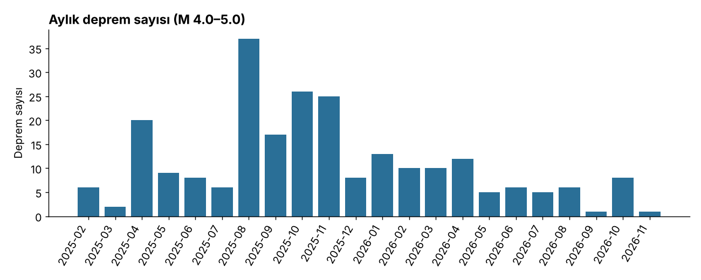
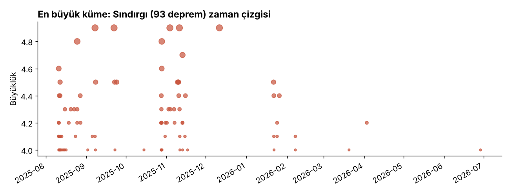
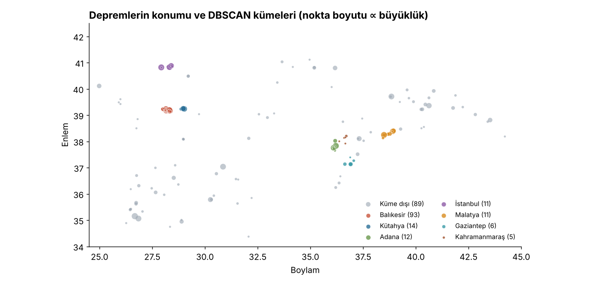
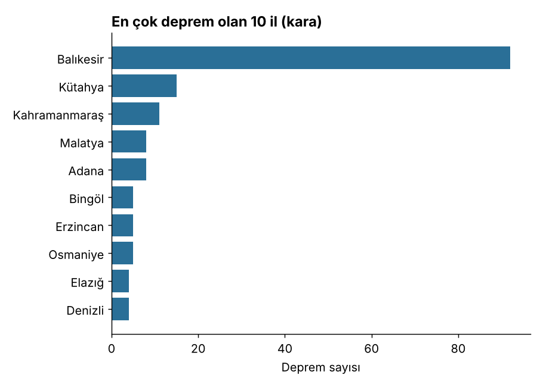
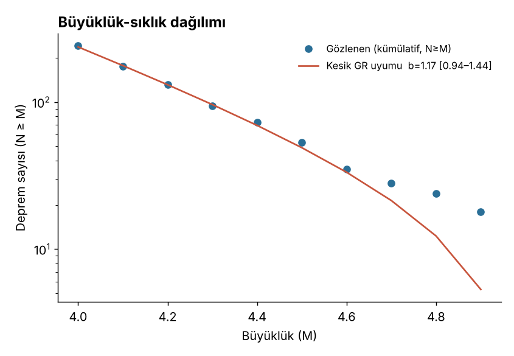
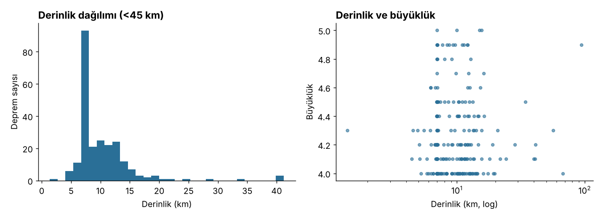

# Türkiye Deprem Kataloğu Analizi (M 4.0–5.0, Şubat 2025 – Kasım 2026)

AFAD kataloğundan alınan 241 depremin keşifsel analizi, mekânsal kümelenmesi ve Gutenberg-Richter b-değeri tahmini. Depremi tahmin etmeye çalışmaz; yalnızca geçmiş kayıtların yapısını inceler.

## Veri
- Kaynak: AFAD deprem kataloğu (deprem.afad.gov.tr). Filtre: büyüklük 4.0–5.0.
- 241 kayıt, tarih aralığı **11.02.2025 – 02.11.2026** (yaklaşık 21 ay).
- Sütunlar: tarih, boylam, enlem, derinlik, RMS, büyüklük türü (MW 218, ML 23), yer, olay kimliği.
- Temizlik: ham dosyada her satır tek bir tırnak içine sarılmıştı, bu yüzden sütunlar ayrılmamıştı. Satırlar ayrıştırıldı, tarihler çevrildi. Eksik ve tekrar eden kayıt yok.

## Sorular ve bulgular

### 1. Depremler zamanda eşit dağılmıyor, birkaç dizi sayıyı belirliyor
- Ayda ortalama 11, medyan 8 deprem var. Ağustos 2025'te 37, Ekim–Kasım 2025'te 26 ve 25 deprem oldu.
- En yoğun günler 28.10.2025 (10 deprem) ve 11.08.2025 (10 deprem). Her ikisi de Sındırgı (Balıkesir) dizisine ait.
- Aralık 2025'ten sonra aylık sayı belirgin düştü.
- Not: Kasım 2026 yalnızca iki günü kapsıyor.





### 2. Mekânsal kümelenme (DBSCAN)
Yöntem: haversine uzaklığı, eps = 25 km, min_samples = 5. 7 küme çıktı ve depremlerin %63'ü bir kümeye düştü.



| Küme | Deprem | Dönem | En büyük M |
|---|---|---|---|
| Sındırgı (Balıkesir) | 93 | 10.08.2025 – 28.06.2026 | 4.9 |
| Simav (Kütahya) | 14 | 21.04.2025 – 11.04.2026 | 4.9 |
| Saimbeyli/Sumbas (Adana–Osmaniye) | 12 | 24.06.2025 – 02.11.2026 | 5.0 |
| Marmara Denizi (İstanbul açıkları) | 11 | 23.04.2025 – 02.10.2025 | 5.0 |
| Malatya çevresi | 11 | 17.02.2025 – 25.08.2026 | 5.0 |
| Nurdağı (Gaziantep) | 6 | 23.10.2025 – 09.08.2026 | 4.6 |
| Göksun/Elbistan (Kahramanmaraş) | 5 | 17.05.2025 – 11.03.2026 | 4.2 |

Tek başına Sındırgı kümesi verinin %39'unu oluşturuyor. Küme sayısı parametrelere duyarlı: eps (15, 25, 40 km) ve min_samples (4, 5, 8) değiştirildiğinde 4 ile 9 arasında küme çıkıyor. Ancak Sındırgı, Simav, Marmara ve Adana çekirdekleri denenen 9 ayarın hepsinde ortaya çıkıyor. Malatya çekirdeği 8 ayarda çıkıyor, en sıkı ayarda (eps 15 km, min_samples 8) kayboluyor. Kuzey Anadolu hattı boyunca dağınık, kümelenmeyen depremler de var.



### 3. Gutenberg-Richter b-değeri
Büyüklük 4.0–5.0 aralığında kesildiği için klasik Aki-Utsu formülü kullanılamaz (üst sınır b'yi yapay olarak yükseltir, 1.39 çıkar). Bunun yerine 4.0–4.9 aralığında kesik dağılıma uygun maksimum olabilirlik tahmini yapıldı ve %95 güven aralıkları bootstrap ile alındı.



| Grup | b | %95 aralık | N |
|---|---|---|---|
| Tümü | 1.17 | 0.94 – 1.44 | 237 |
| Sındırgı (Balıkesir) | 1.20 | 0.83 – 1.62 | 92 |
| Diğer bölgeler | 1.15 | 0.85 – 1.47 | 145 |
| Kümelerdeki depremler | 0.98 | 0.68 – 1.29 | 149 |
| Kümeler dışı depremler | 1.54 | 1.14 – 2.01 | 88 |

Yorum: Genel b-değeri tektonik bölgelerde beklenen 1 civarında, ama aralık geniş. Sındırgı ile diğer bölgeler arasında fark görünmüyor. Kümeler dışındaki depremler daha yüksek b gösteriyor (küçük depremlerin göreli payı daha fazla), ancak aralıklar kısmen örtüştüğü için bu fark kesin sayılmaz.
Not: 4.7 üstünde gözlenen sayılar uyum eğrisinin biraz üzerinde kalıyor. Dar bir aralıkta ve az sayıda depremle çalıştığımız için bunu kesin bir fiziksel sonuç olarak yorumlamak doğru olmaz.

### 4. Derinlik
- Medyan derinlik 8.7 km, depremlerin %80'i 6.9–14.8 km arasında.
- 45 depremin (%19) derinliği tam 7.0 km. Bu AFAD'ın derinliği çözemediğinde kullandığı sabit değere benziyor, gerçek ölçüm değil.
- 30 km üstü 7 deprem var ve hepsi güney ve batı açıklarında ya da Antalya çevresinde (en derini Aksu, 94 km).
- Derinlik ile büyüklük arasında ilişki yok (Spearman ρ = −0.02, p = 0.81).
- Simav'da 21.04.2025 tarihli bir kaydın RMS değeri 13.5 (diğerleri 0.2–1.1) ve derinliği 1.4 km. Konum çözümü güvenilmez görünüyor. Kayıt silinmedi, işaretlendi.



## Sınırlılıklar
- Filtre 5.0 üstünü içermiyor. Büyük olasılıkla Nisan 2025 Marmara ve Ağustos 2025 Sındırgı gibi dizilerin ana şokları veride yok. Bu yüzden artçı ve ana şok ilişkisi (Omori yasası) analiz edilemedi.
- 21 aylık dönem uzun vadeli sismisite için kısa. Sonuçlar bu dönemin özetidir, genel bir eğilim değildir.
- Harita altlığı (il sınırları, kıyı çizgisi) kullanılmadı, noktalar enlem-boylam düzleminde çizildi.
- Büyüklük türleri karışık (MW ve ML), ayrı ele alınmadı.

## Nasıl çalıştırılır
Python 3.10 veya üstü gerekir.

```bash
pip install -r requirements.txt
python kod/00_temizle.py     # ham veriyi temizler
python kod/01_analiz.py      # keşif, DBSCAN, grafikler
python kod/02_b_kesik.py     # kesik b-değeri ve grafik
```

## Klasör yapısı
- `veri/afad_ham.csv`: AFAD'dan indirilen ham dosya
- `veri/depremler_temiz.csv`: temizlenmiş veri
- `veri/depremler_kumeli.csv`: il, deniz bilgisi ve küme etiketleri eklenmiş veri
- `sonuclar/`: küme özeti ve hesaplanan tüm sayılar (`kume_ozeti.csv`, `sonuclar.json`, `b_kesik.json`)
- `grafikler/`: 6 grafik
- `kod/`: analiz betikleri (pandas, scikit-learn, scipy, matplotlib)
